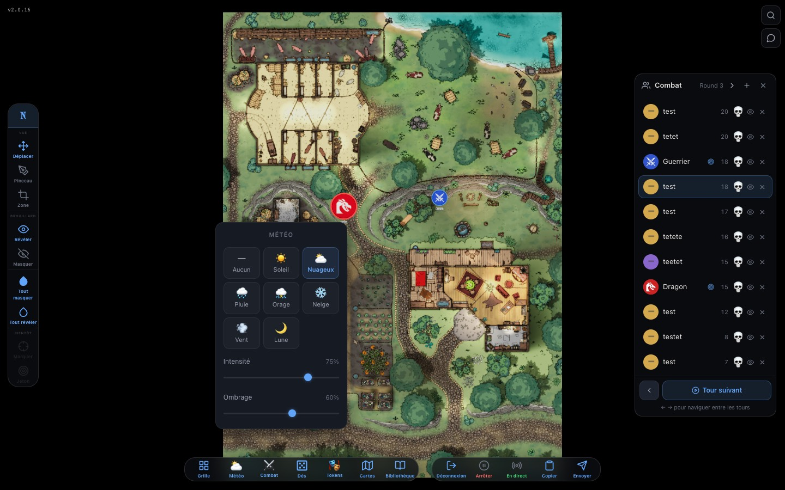
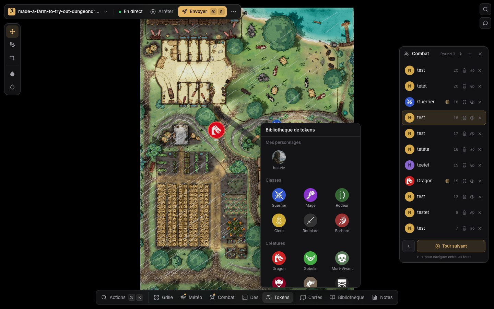

# Navis v2 — rapport de l'existant et refonte de l'interface

_15 novembre 2026 — branche `feature/design-navis`, rien n'est commité._

## En bref

L'écran du MJ a été réorganisé autour d'une idée : **ce qui compte en partie (quelle carte, est-elle en direct, l'envoyer) est en haut, les outils de dessin à gauche, tout le reste dans un seul dock en bas.** L'identité visuelle est « graphite & laiton », dans l'esprit de Raycast : interface neutre et dense, pilotée au clavier, où la carte est la seule chose colorée à l'écran.

Au passage, trois vrais bugs ont été corrigés, dont un bloquant : **le mode développement (`npm run dev`) ne démarrait plus du tout.**

| Avant | Après |
| --- | --- |
|  |  |

Palette de commandes : [apres-palette.jpg](v2/apres-palette.jpg). Vue joueur et vue MJ sur petit écran : [apres-joueur.jpg](v2/apres-joueur.jpg), [apres-mj-mobile.jpg](v2/apres-mj-mobile.jpg).

Vérifié : types (`tsc`), 103 tests, build de production, et rendu réel dans un Chromium headless (captures ci-dessus). **Non vérifié** : rendu sur un vrai GPU, tactile, application Android TV.

---

## 1. Constat sur l'existant

### Ergonomie

| Problème | Conséquence |
| --- | --- |
| Libellés des boutons en **8 px**, titres de section en **6 px** | Illisibles, surtout sur un portable à table |
| Tous les boutons du bas étaient bleus (« actifs ») en permanence | Impossible de voir ce qui est réellement activé |
| « Déconnexion » collé à « Arrêter » et « Envoyer » | Risque de se déconnecter en pleine partie |
| L'état de diffusion était un simple pictogramme parmi dix | L'information la plus importante du MJ était noyée |
| Aucun retour après « Envoyer » | On ne savait pas si les joueurs avaient reçu la carte |
| Deux outils grisés « Bientôt » affichés en permanence | Du bruit sans fonction |
| Icônes au trait mélangées à des emojis (🎭 ⚔️ ⛅) | Aspect disparate, rendu différent selon l'OS |
| Les notes n'avaient **aucun bouton** (seulement la recherche Ctrl+Maj+F) | Fonction existante mais introuvable |
| Trois familles de couleurs (bleu, violet `#1a1a2e`/`#333366`, gris Chakra) | Chaque fenêtre semblait venir d'une appli différente |
| Textes anglais restants (« Import Map or Media Library Item »…) | Incohérent avec le reste en français |

### Implémentation

| Problème | Gravité |
| --- | --- |
| **`npm run dev` plantait** : « require is not defined » (Relay émet du `require`, le serveur de dev Vite 8 sert de l'ESM) | Bloquant en dev |
| **Ctrl/⌘+S utilisait la carte du premier affichage** : après un changement de carte, le raccourci pouvait envoyer le brouillard vers l'ancienne carte | Bug de partie |
| **Dessiner du brouillard annulait un « Envoyer » en cours** (mauvaise référence annulée dans `saveFogProgress`) | Bug de partie |
| Les touches 1–5 changeaient d'outil même pendant la saisie dans un champ | Gênant |
| Blocage du clic droit côté joueur jamais actif (écouteur ajouté puis retiré dans le nettoyage) | Mineur |
| La police Inter n'était **jamais chargée** (`@import` placé après d'autres règles, donc ignoré) — et dépendait de Google Fonts | Mineur, mais cassait l'usage hors ligne |
| Code mort dans la vue joueur (barre « déplaçable » dont la position n'était jamais appliquée) | Dette |

### Performance

- **La carte était redessinée 60 fois par seconde même immobile** (boucle de rendu continue). **Corrigé** — voir « Rendu à la demande » plus bas.
- **Bundle lourd** : un morceau de 1,08 Mo (éditeur/rendu HTML des notes et du chat), un de 733 Ko, l'index à 556 Ko. Le joueur télécharge une bonne partie de ce dont seul le MJ a besoin.

---

## 2. Ce qui a changé

### Écran du MJ

- **Barre de session (haut gauche)** : nom de la carte (clic = changer de carte), état en toutes lettres (« En direct », « Autre carte en direct », « Hors ligne »), « Arrêter », et **« Envoyer » comme seul bouton plein** de l'écran, avec son raccourci affiché. Un message confirme l'envoi ou signale l'échec.
- **Menu « ⋯ »** : copie de l'image, déconnexion (éloignée du reste), numéro de version.
- **Rail d'outils (gauche)** : boutons carrés à icône seule ; le nom et la touche apparaissent en infobulle. Révéler / Masquer n'apparaît qu'avec le pinceau ou la zone. Les outils « Bientôt » ne sont plus affichés (le code est conservé).
- **Dock (bas)** : Actions, Grille, Météo, Combat, Dés, Tokens, Cartes, Bibliothèque, **Notes** (nouveau bouton). Icône et libellé sur une ligne ; libellés masqués sur petit écran.
- **Palette de commandes (⌘K / Ctrl+K)** : un seul champ pour envoyer la carte, changer d'outil, régler la météo, lancer un dé, ouvrir une fenêtre, **changer de carte** et **chercher dans les notes**. Elle remplace l'ancienne recherche de notes (Ctrl+Maj+F et la loupe en haut à droite l'ouvrent aussi).
- **Le laiton ne sert qu'à deux choses** : l'action principale et l'outil sélectionné. Un état en cours (météo active, combat) est signalé par une simple pastille.

### Toute l'application

- **Jetons dans `src/design-system.ts`** : surfaces graphite sans teinte, filet de 1 px, liseré clair en haut des fenêtres, une seule ombre. Trois niveaux de texte. Rayons de 12 px (fenêtres), 8 px (contrôles), 6 px (touches) : plus de pilules.
- **Inter embarquée** dans l'application (plus de dépendance à Google Fonts, donc fonctionne hors ligne), 13 px. Folkard reste réservée au logo.
- **Primitives partagées** dans `src/ui.tsx` (surface flottante, contrôle de 32 px, touche clavier) ; boutons et champs ramenés à ce gabarit.
- La centaine de couleurs codées en dur (bleus et violets) dans 27 fichiers a été alignée sur les jetons. Emojis remplacés par des icônes au trait (météo, combat, liste des cartes, menus) et libellés en majuscules supprimés.
- Anneau de focus visible au clavier, respect de « réduire les animations ».

### Rendu à la demande

La carte n'est plus redessinée en permanence (`src/render-scheduler.tsx`) :

| Situation | Avant | Maintenant |
| --- | --- | --- |
| MJ, carte immobile, sans météo | cadence de l'écran (60/s) | ~4 images/s (simple filet de sécurité) |
| Joueur, sans météo (brouillard qui dérive) | cadence de l'écran | 30 images/s |
| Météo, GIF ou vidéo en cours | cadence de l'écran | inchangé |
| Pendant une interaction et 1,5 s après | cadence de l'écran | inchangé |

Mesuré en headless : ~4,8 rendus/s au repos côté MJ, et pinceau, zoom, météo et synchronisation MJ→joueur fonctionnent toujours. Le rendu logiciel du headless plafonne à quelques images par seconde : **la fluidité réelle reste à contrôler sur votre machine et sur la TV** (en particulier le brouillard des joueurs à 30 images/s).

### Corrections

Les cinq premiers problèmes d'implémentation du tableau ci-dessus sont corrigés, ainsi que la police et le code mort de la vue joueur. Le correctif du mode dev est un petit plugin dans `vite.config.ts`, actif **uniquement en dev** : le build de production est inchangé.

Un changement de comportement à connaître : **le clic droit du navigateur est maintenant réellement bloqué côté joueur** (c'était l'intention du code d'origine, mais ça n'avait jamais fonctionné).

---

## 3. Ce qui reste, par ordre d'intérêt

1. **Alléger ce que charge le joueur** : charger l'éditeur de notes et le rendu Markdown seulement quand on les ouvre.
2. **Finir l'harmonisation** : les fenêtres de préparation du combat, de la bibliothèque et de l'éditeur de notes héritent des nouveaux jetons mais n'ont pas été redessinées une à une ; les écrans de connexion et d'attente n'ont pas pu être capturés (pas de mot de passe en local).
3. **Mot de passe** stocké en clair dans le navigateur et accepté dans l'URL (`?password=`) : pratique pour la TV, mais il se retrouve dans l'historique et les journaux.
4. `src/version.ts` indique 2.0.16 alors que `package.json` est en 2.0.17.
5. Deux avertissements React préexistants (un `<button>` dans un `<button>`, la prop `isSideBarVisible` passée au DOM).

Le serveur (GraphQL, SQLite, routes) n'a **pas** été audité en profondeur dans cette passe.

## 4. Outils (MCP) conseillés

- **Extension Claude in Chrome** : elle n'était pas connectée, j'ai donc vérifié le rendu dans un Chromium headless avec rendu logiciel. Connectée, elle permet de tester sur votre vrai navigateur et votre GPU (météo, brouillard, fluidité).
- **GitHub** (à autoriser via `/mcp`) : utile seulement si vous voulez que j'ouvre la PR et suive la CI.

Rien d'autre n'est nécessaire.
